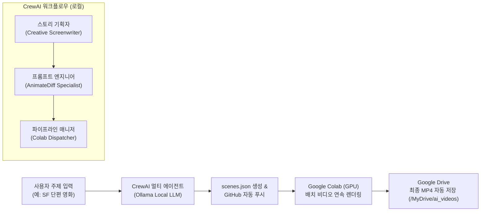

# 🎬 CrewAI ➔ GitHub ➔ Colab ➔ Google Drive AI 비디오 생성 파이프라인

로컬의 **CrewAI 멀티 에이전트(Ollama 로컬 LLM 구동)**를 활용하여 씬별 스토리와 AnimateDiff 전용 비디오 프롬프트를 자동으로 생성하고, GitHub를 거쳐 **Google Colab (GPU)**에서 무인 배치 렌더링한 뒤 최종 MP4 파일을 **Google Drive**에 자동 수집하는 완전 자동화 파이프라인입니다.

---

## 🏗 전체 아키텍처



---

## 📂 프로젝트 구조

```
CrewAI_Colab/
├── config/
│   ├── agents.yaml           # 에이전트 역할, 목표, 백스토리 정의
│   └── tasks.yaml            # 기획, 프롬프트 변환, JSON 출력 태스크 정의
├── colab_runner.ipynb        # Google Colab 원클릭 실행 노트북
├── batch_generator.py        # Colab용 scenes.json 일괄 배치 렌더러
├── video_generator.py        # AnimateDiff 파이프라인 및 VRAM 최적화 모듈
├── crew.py                   # CrewBase 멀티 에이전트 오케스트레이션 (Ollama LLM)
├── main.py                   # 로컬 기획 실행 및 CLI 진입점
├── git_sync.py               # scenes.json GitHub 자동 커밋 & 푸시 모듈
├── models.py                 # Pydantic 기반 씬 데이터 스키마
├── scenes.json               # Colab 배치 렌더링용 씬 정의 데이터
├── requirements.txt          # 필요 패키지 목록
└── .env.example              # Ollama 및 환경 변수 템플릿
```

---

## 🚀 빠른 시작 가이드

### 1단계: 로컬 환경 설정 (CrewAI & Ollama)

1. **Ollama 모델 다운로드 및 실행:**
   ```bash
   ollama run llama3.2
   ```

2. **파이썬 가상환경 생성 및 의존성 설치:**
   ```bash
   python3 -m venv .venv
   source .venv/bin/activate
   pip install -r requirements.txt
   ```

3. **환경 변수 복사:**
   ```bash
   cp .env.example .env
   ```
   > 기본값으로 `OLLAMA_MODEL=ollama/llama3.2`, `OLLAMA_BASE_URL=http://localhost:11434`가 설정되어 있습니다.

---

### 2단계: 로컬에서 CrewAI 비디오 기획 실행

원하는 영상 주제를 입력하여 `scenes.json`을 생성합니다:

```bash
# 기본 실행 (scenes.json 생성)
python main.py -t "사이버펑크 네온 도시를 질주하는 미래형 비행 바이크와 이를 추격하는 드론"

# GitHub 원격 저장소에 자동 푸시까지 한 번에 실행:
python main.py --push -t "깊은 심해의 발광 생명체와 고대 유적을 탐사하는 잠수정"
```

생성 완료 후 GitHub로 푸시하려면 별도로 다음 명령을 실행할 수도 있습니다:
```bash
python git_sync.py
```

---

### 3단계: Google Colab에서 원클릭 배치 렌더링

1. [Google Colab](https://colab.research.google.com/)에서 본 프로젝트의 `colab_runner.ipynb`를 엽니다.
2. 상단 메뉴에서 **런타임 ➔ 런타임 유형 변경 ➔ T4 GPU**를 선택합니다.
3. 노트북의 6개 셀을 순서대로 실행합니다:
   - **셀 1:** Google Drive 마운트 (`/content/drive/MyDrive/ai_videos`)
   - **셀 2:** GPU 확인 및 라이브러리 설치
   - **셀 3:** GitHub 저장소 clone 또는 최신 `scenes.json` pull
   - **셀 4:** 가져온 씬 프롬프트 확인
   - **셀 5:** `batch_generator.py`를 통한 일괄 비디오 렌더링
   - **셀 6:** 생성된 MP4 미리보기 재생

모든 비디오는 구글 드라이브의 `ai_videos` 폴더에 자동 저장되므로 Colab 세션이 종료되어도 영구 보존됩니다! 💾
